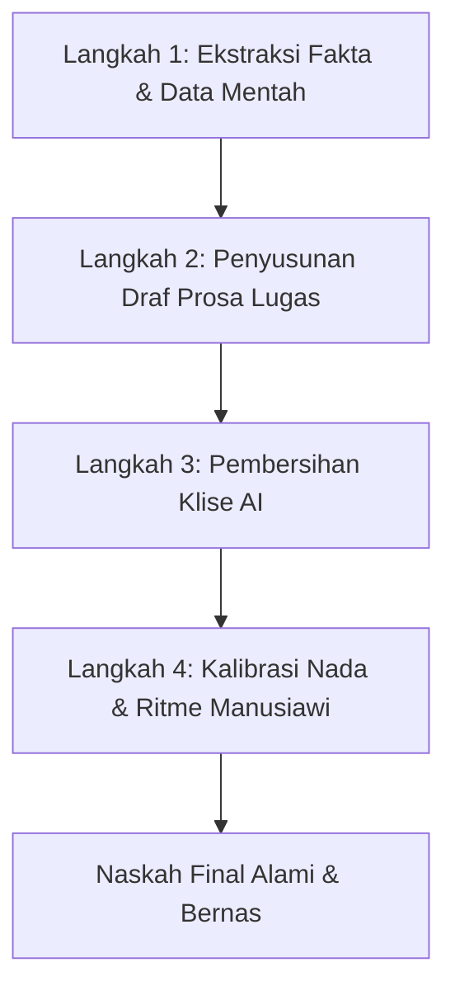

# Skill: Penulisan Alami & Manusiawi (Natural & Human Writing)

Skill ini dirancang untuk melatih dan memandu agen AI dalam menghasilkan prosa yang terasa autentik, bernas, dan ditulis oleh pakar manusia. Panduan ini dibangun di atas temuan empiris ensiklopedia Wikipedia mengenai karakteristik tulisan AI (*Signs of AI Writing*) yang mencakup kebiasaan *statistical regression to the mean*—kecenderungan model bahasa meratakan nuansa spesifik menjadi kalimat-kalimat generik bernada megah dan seragam.

---

## 1. Filosofi Inti: Menulis Seperti Pakar Manusia

Penulis manusia yang ahli memiliki ciri khas yang bertolak belakang dengan pola dasar AI:
1. **Lugas Mengalahkan Hiasan (*Directness over Decoration*)**: Sampaikan fakta dan data apa adanya. Jangan membungkus fakta sederhana dengan retorika puitis atau megah.
2. **Spesifik Mengalahkan Abstrak (*Specifics over Abstractions*)**: Sebutkan nama senyawa, angka rendemen, mekanisme reaksi, atau tahun secara presisi daripada memakai kata payung kabur seperti *"berbagai faktor"*, *"lanskap dinamis"*, atau *"anyaman tradisi"*.
3. **Variasi Ritme Kalimat (*Organic Cadence & Burstiness*)**: Manusia mencampur kalimat pendek yang tegas dengan kalimat majemuk berstruktur alami. AI cenderung memproduksi kalimat dengan panjang dan struktur anak-kalimat yang seragam.
4. **Prosa Mengalir Mengalahkan Fragmentasi Daftar (*Prose over Lists*)**: Jangan memecah narasi logis menjadi daftar berpoin (*bullet points*) berulang dengan judul tebal, kecuali jika menyajikan data paralel (seperti tabel spesifikasi atau daftar pustaka).

---

## 2. Delapan Dosa Besar Penulisan AI (The 8 AI Writing Tells)

Hindari 8 pola berikut yang menjadi tanda utama (*tells*) teks hasil generasi AI:

### 1. Pembesaran Makna & Tren Semu (*Undue Significance & Legacy Puffery*)
* **Ciri AI**: Selalu mengaitkan topik kecil dengan sejarah besar, revolusi industri, tren global, atau warisan abadi peradaban (*"marking a pivotal moment"*, *"stands as a testament"*, *"merupakan bukti nyata dari pergeseran paradigma..."*).
* **Solusi Manusiawi**: Batasi analisis pada lingkup faktualnya. Jika membahas ekstraksi minyak nilam, jelaskan sifat fisiko-kimia dan rendemennya, jangan melompat ke klaim filosofis tentang harmoni manusia dan alam.

### 2. Diksi Klise AI (*High-Density AI Vocabulary*)
* **Ciri AI**: Pengulangan kata-kata favorit LLM seperti: *delve/menyelami, crucial/krusial, pivotal, landscape/lanskap, tapestry/anyaman, foster/menumbuhkan, bolster/memperkuat, enhance/meningkatkan, testament/bukti nyata, intricate/rumit, nuanced/bernuansa, robust/tangguh, additionally/terlebih lagi (sebagai pembuka kalimat)*.
* **Solusi Manusiawi**: Gunakan kosa kata fungsional yang lugas. Lihat tabel padanan lengkap di [vocabulary-blacklist.md](./references/vocabulary-blacklist.md).

### 3. Menghindari Kopula Dasar (*Copula Avoidance Syndrome*)
* **Ciri AI**: Enggan menggunakan kata kerja sederhana seperti *adalah*, *merupakan*, *punya*, atau *memiliki*. Digantikan frasa berputar-putar seperti: *berfungsi sebagai*, *bertindak selaku*, *menawarkan karakteristik*, *menampilkan fitur*, *hadir sebagai manifestasi dari*.
* **Solusi Manusiawi**: Beranilah menulis kalimat sederhana: *"Ekstrak sirih adalah antibakteri alami"*, bukan *"Ekstrak sirih berfungsi sebagai agen antibakteri yang tangguh"*.

### 4. Paralelisme Negatif Retoris (*Negative Parallelisms*)
* **Ciri AI**: Menggunakan formula perbandingan klise seolah membantah kesalahpahaman umum:
  - *"Bukan sekadar X, melainkan juga Y..."* (*Not just X, but also Y*)
  - *"Bukan X yang menjadi penentu, melainkan Y..."* (*Not X, but Y*)
  - *"Apakah di laboratorium maupun di industri, X tetap menjadi primadona..."*
* **Solusi Manusiawi**: Langsung nyatakan subjek dan predikatnya tanpa framing retorika pemasaran.

### 5. Pola Tiga Serangkai yang Dipaksakan (*Forced Rule of Three*)
* **Ciri AI**: Selalu menyusun kata sifat, kata kerja, atau klausa dalam kelompok tiga: *"efektif, efisien, dan berkelanjutan"*, *"meningkatkan A, memperkuat B, dan mendorong C"*, *"kualitas, keamanan, dan integritas"*.
* **Solusi Manusiawi**: Tuliskan jumlah hal yang memang nyata dan relevan—bisa satu hal, dua hal spesifik, atau empat langkah terukur. Jangan memaksakan trio ritmis.

### 6. Analisis Dangkal Berpartisip Ekor (*Dangling Present Participles / "-ing" Trap*)
* **Ciri AI**: Menggantungkan frasa analisis dangkal di akhir kalimat menggunakan kata kerja aktif: *", menandai tonggak penting dalam..."*, *", memastikan integrasi optimal antara..."*, *", menyoroti komitmen berkelanjutan terhadap..."*.
* **Solusi Manusiawi**: Buat kalimat tuntas dengan titik. Jika ada dampak atau mekanisme sebab-akibat, uraikan mekanismenya secara terpisah dengan data/fakta konkrit.

### 7. Format Visual Monoton & Tanda Baca Berlebihan (*Over-Formatting & Em-Dashes*)
* **Ciri AI**:
  - Format daftar vertikal berpola seragam: `* **Nama Topik:** Penjelasan kalimat pertama...` pada hampir setiap sub-bagian.
  - Penebalan teks (*boldface*) yang berlebihan di tengah-tengah kalimat.
  - Penggunaan tanda hubung panjang (*em dash* `—`) secara obsesif untuk memberi jeda dramatis ala tulisan promosi.
* **Solusi Manusiawi**: Susun dalam paragraf prosa mengalir (*fluid prose*). Gunakan tanda koma, titik dua, atau tanda kurung secara wajar. Gunakan bullet point hanya untuk daftar enumerasi teknis.

### 8. Penutup Klise "Tantangan dan Masa Depan" (*The Outline-Conclusion Trap*)
* **Ciri AI**: Hampir setiap bab atau artikel diakhiri paragraf berpola kaku: *"Meskipun memiliki berbagai keunggulan, [Subjek] menghadapi sejumlah tantangan... Namun, dengan inovasi berkelanjutan, masa depannya tetap cerah."*
* **Solusi Manusiawi**: Jangan menutup teks teknis dengan klise optimisme kosong. Tutup dengan ringkasan temuan objektif, batasan metode saat ini, atau arah riset empiris yang belum terselesaikan.

---

## 3. Alur Kerja Rekonstruksi & Penulisan Alami

Saat agen ditugaskan menyusun atau menyunting naskah, terapkan prosedur 4 langkah berikut:

### Langkah 1: Kumpulkan Fakta Tanpa Bumbu Adjektiva
- Catat data mentah: senyawa aktif, konsentrasi, metode ekstraksi, angka uji, literatur rujukan, dan batasan teknis.
- Singkirkan prasangka bahwa teks teknis harus terdengar "canggih" atau "mengagumkan". Kejelasan adalah bentuk kecanggihan tertinggi.

### Langkah 2: Susun Kalimat Berbasis Prosa Mengalir (Bukan Bullet Points)
- Rangkai kalimat dengan struktur utama SPOK (Subjek - Predikat - Objek - Keterangan).
- Jangan membuat daftar berpoin jika hubungan antar gagasan adalah hubungan kronologis, kausalitas, atau perbandingan logis; gunakan paragraf terhubung.

### Langkah 3: Bersihkan Klise & Kata Terlarang
- Lakukan pemindaian terhadap daftar kata terlarang di [vocabulary-blacklist.md](./references/vocabulary-blacklist.md).
- Ganti frasa pembesar makna (*puffery*) dengan pernyataan faktual.
- Hapus paralelisme negatif (*"bukan hanya... melainkan..."*) dan ubah menjadi pernyataan langsung.

### Langkah 4: Uji Ritme Kalimat (*Burstiness & Tone Audit*)
- Baca draf secara visual: apakah ada kalimat 8 kata, diikuti kalimat 22 kata, lalu kalimat 14 kata? (Variasi = Alami).
- Jika semua kalimat berpanjang sama (rata-rata 18–22 kata) dengan struktur pembuka serupa (*"Selain itu, ..."*, *"Dalam konteks ini, ..."*), pecah dan variasikan struktur sintaksisnya.

---

## 4. Daftar Periksa Mandiri Agen (Self-Audit Checklist)

Sebelum menyerahkan hasil tulisan kepada pengguna, agen wajib memverifikasi poin-poin berikut:

| No | Poin Audit | Pertanyaan Verifikasi | Status Lolos |
|:---|:---|:---|:---:|
| 1 | **Bebas Pembesaran Makna** | Apakah ada klaim *"tonggak sejarah"*, *"bukti nyata"*, atau pergeseran tren yang tidak didukung data? | Harus TIDAK ada |
| 2 | **Diksi Alami** | Apakah ada kata terlarang (*delve, lanskap, anyaman, krusial, meningkatkan, menumbuhkan*)? | Harus BERSIH |
| 3 | **Kopula Normal** | Apakah subjek didefinisikan dengan *adalah/memiliki*, bukan *berfungsi sebagai/menawarkan*? | Harus LUGAS |
| 4 | **Bebas Paralelisme Negatif** | Apakah ada frasa *"bukan sekadar... melainkan juga..."*? | Harus DIHAPUS |
| 5 | **Bebas Pola Tiga Serangkai** | Apakah ada trio kata sifat/frasa yang terasa dipaksakan ritmenya? | Harus DIPERIKSA |
| 6 | **Prosa Mengalir** | Apakah teks didominasi paragraf utuh, bukan daftar bullet `**Judul:** Penjelasan`? | Harus PROSA |
| 7 | **Bebas Em-Dash Berlebihan** | Apakah tanda pisah panjang (`—`) dihilangkan atau diganti tanda baca alami? | Harus WAJAR |
| 8 | **Penutup Faktual** | Apakah bagian penutup bebas dari formula *"Meskipun ada tantangan, masa depan cerah"*? | Harus FAKTUAL |

---

## 5. Sumber Daya Referensi Tambahan

Untuk mempelajari detail spesifik dan melihat contoh transformasi kalimat sebelum-sesudah:
- [Rangkuman Temuan Wikipedia: Signs of AI Writing](./references/wikipedia-signs-of-ai.md): Analisis lengkap fenomena linguistik AI berdasarkan dokumentasi resmi Wikipedia.
- [Daftar Hitam Kosa Kata & Frasa AI (ID & EN)](./references/vocabulary-blacklist.md): Tabel lengkap kata klise AI dan alternatif alaminya.
- [Contoh Transformasi Sebelum-Sesudah](./examples/before-after-comparisons.md): Studi kasus perbaikan naskah buku ilmiah, kimia bahan alam, dan tinjauan literatur.
